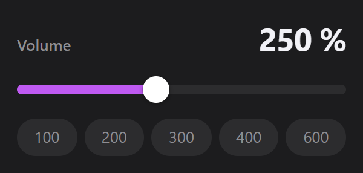

# Volume Boost

A Chrome extension that makes quiet videos louder. A slider in the toolbar raises the volume of the current tab up to 600 %, and fullscreen keeps working.

## What it does

- **Up to 600 %.** Drag the slider to amplify every video and audio player on the page, including players inside frames.
- **Fullscreen keeps working.** The boost is applied to the page's own sound, so video players behave as usual.
- **One click for the usual levels.** The buttons under the slider jump to 100, 200, 300, 400 or 600 %; 100 is back to normal.
- **Leaves pages alone until you use it.** Nothing is changed on a page before you move the slider.

The interface is in French.

## Install

The extension is not on the Chrome Web Store, so it is loaded by hand:

1. Download this repository (**Code**, then **Download ZIP**) and unzip it, or clone it.
2. Open `chrome://extensions` and turn on **Developer mode**.
3. Click **Load unpacked** and choose the folder.

## Good to know

- Tabs that were already open when you installed the extension need a reload before the slider works on them.
- The boost applies to the current page and returns to 100 % when the page reloads.
- A few players cannot be boosted: media served from another site without sharing permission is left untouched, because boosting it would mute it.
- High values can distort the sound. Raise the slider gradually.

## Privacy

Everything stays on your computer. The extension has no server, stores nothing and makes no network requests. It runs on all sites only so the slider can reach the page's players.

## License

[MIT](LICENSE) © 2026 Yanis Arris
